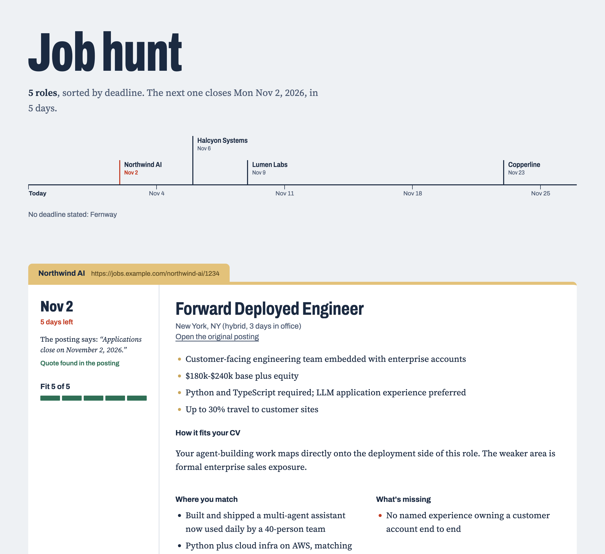
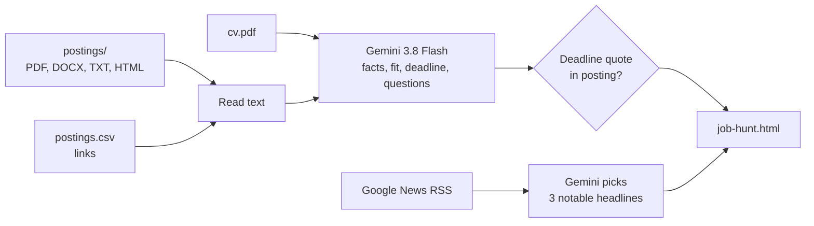

<div align="center">

# 📂 Job Hunt in a Folder

**Drop in your CV and a few job postings. Get one page that tells you what to apply to first, and why.**


-2F6F55?logo=googlegemini&logoColor=white)




<sub>Screenshot uses fictional companies and a fictional CV.</sub>

</div>

---

## ✨ What you get

For every posting, a local web page shows:

- 🗓️ **The deadline**, with the exact sentence from the posting it came from, and a check that the sentence is really there.
- 🎯 **A 1-to-5 fit score** against your CV, with where you match and what's missing.
- 📌 **Key facts**: team, pay, location, must-have skills.
- 💬 **Three likely interview questions**, tied to the role and to your background.
- 📰 **Recent company news**, each fact linked to its source article.

Roles are sorted by deadline, and a timeline at the top shows what closes next.

## 🧭 How it works



## 🚀 Quick start

```bash
cd job-hunt-in-a-folder
uv venv .venv && uv pip install --python .venv/bin/python -r requirements.txt
cp .env.example .env          # paste your Gemini key into .env
```

Get a free key at [Google AI Studio](https://aistudio.google.com/apikey). Then:

1. Save your CV in this folder as **`cv.pdf`**.
2. Add postings, either way:
   - drop files into **`postings/`** (`.pdf` `.docx` `.txt` `.md` `.html`)
   - or add links to **`postings.csv`**, one per row, with an optional note
3. Build the page:

```bash
.venv/bin/python build.py            # build job-hunt.html and open it
.venv/bin/python build.py --watch    # rebuild every time you drop in a posting
.venv/bin/python build.py --no-news  # skip the company news
```

> [!TIP]
> Some links (LinkedIn especially) need a login or load with JavaScript, so they come back almost empty. The page lists those under **Couldn't read**. Save the posting as a PDF into `postings/` instead.

## 🧗 All three levels

| Level | The ask | How it's built |
|:--|:--|:--|
| 🟢 **Starter** | Add a 1-to-5 fit score and sort by deadline | `fit_score` in the model's structured output; `render()` sorts by deadline, then fit |
| 🔵 **Builder** | Rebuild the page every time a posting is dropped in | `--watch` uses `watchdog` on `postings/` and `postings.csv`; the open page refreshes itself |
| 🟣 **Power User** | Recent news on each company, with a source for every fact | Google News RSS supplies real articles; Gemini only picks among them and cites by number |

Everything runs on the **Gemini free tier**. Results are cached in `.cache/`, so a rebuild only calls the model for postings that are new or changed.

## 🔍 Building trust

The handout says to check one summary against the original posting, and to ask where each deadline came from. The tool answers the second question on the page itself.

| Claim | How it's checked |
|:--|:--|
| **Deadline** | The model must copy the sentence that states the deadline. The script searches the posting for it and shows ✅ *Quote found in the posting* or ⚠️ *Quote not found*. No deadline in the posting means the page says so instead of guessing, and a "posted on" date never counts. |
| **News** | The script fetches real headlines first. The model can only pick from that list by number, so every fact links to an article that exists. A pick that points outside the list is dropped. |
| **Fit** | Each match names the CV evidence behind it, and gaps are listed next to it, so you can check the score against your own read. |

> [!NOTE]
> What it doesn't verify: key facts and fit summaries aren't checked line by line. Spot-check one against the posting, as the handout asks.

**What I found when I checked:** on a real Anthropic FDE posting, the first prompt gave a 5/5 fit while also listing a London-only location and an 8+ years requirement as gaps. It also referred to me by name with gendered pronouns. I tightened the prompt: hard requirements you miss now lower the score (that role dropped to 4/5), and the page speaks to you as "you". If the free model is overloaded, the script switches to a fallback model instead of waiting.

## 🗂️ What's in the folder

```
job-hunt-in-a-folder/
├── build.py          # reads, analyzes, verifies, renders, watches
├── template.html     # the page design (Jinja2)
├── postings/         # drop posting files here
├── postings.csv      # or list links here
├── .env.example      # copy to .env and add your key
├── cv.pdf            # your CV        (gitignored)
├── .env              # your API key   (gitignored)
└── job-hunt.html     # the output     (gitignored, it quotes your CV)
```

## 🔭 Where it goes next

**Track applications, not just postings.** Add a status (applied, interviewing, rejected) and a follow-up date to `postings.csv`. The timeline would then show what to *do* next, not only what closes next. Pulling recruiter replies from email would keep each status current without manual updates.
